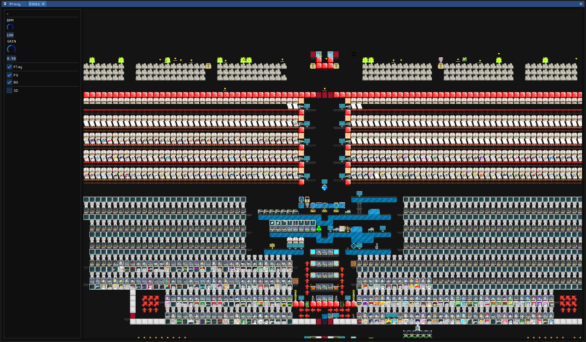
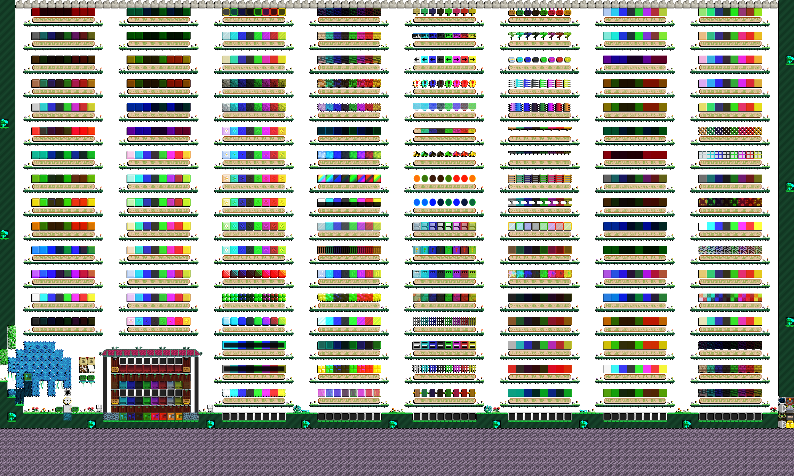
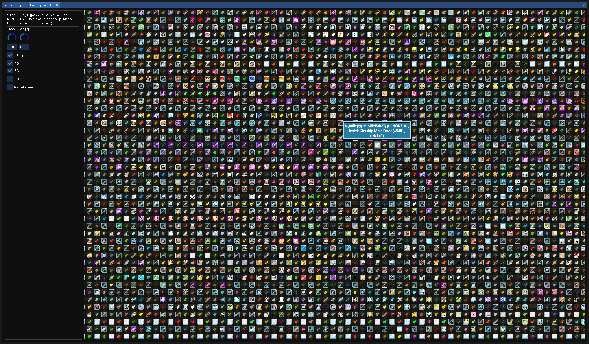
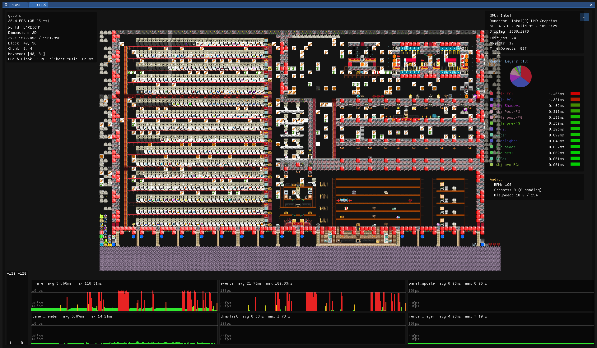
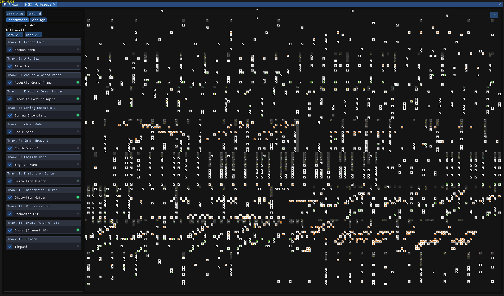

<table align="center" width="100%">
  <tr>
    <td align="center" width="50%">
      <p><b>Native GUI Using OpenGL</b></p>
      
    </td>
    <td align="center" width="50%">
      <p><b>Render to Image</b></p>
      
    </td>
  </tr>
  <tr>
    <td align="center" width="50%">
      <p><b>Debug World</b></p>
      
    </td>
    <td align="center" width="50%">
      <p><b>Debug UI</b></p>
      
    </td>
  </tr>
  <tr>
    <td align="center" width="50%">
      <p><b>Convert Midi to Notes</b></p>
      
    </td>
  </tr>
</table>


> [!NOTE]
> clone with submodule (if already cloned): `git submodule update --init --recursive`
>
> clone with submodule: `git clone --recurse-submodules https://github.com/ToyFarms/gtools`

```
prerequisites:

- uv (https://docs.astral.sh/uv)

setup:

install uv:
for linux
$ curl -LsSf https://astral.sh/uv/install.sh | sh
for windows
$ powershell -ExecutionPolicy ByPass -c "irm https://astral.sh/uv/install.ps1 | iex"

install python:
$ uv python install 3.13
(at least python >= 3.12)

$ uv venv --python 3.13
$ source .venv/bin/activate
(or `.\.venv\Scripts\activate` on windows)
$ uv sync
(use `uv sync --extra gui` if you want to use the gui)

usage:

help:
$ python main.py --help

to test connectivity:
$ python main.py test

to run the proxy:
$ python main.py proxy

to run the script:
use ./s <args> in linux or ./s.cmd <args> in windows,
or directly invoke scripts/cli.py (need to set env PYTHONPATH=.)

test:

to run the test
$ ./s test
or
$ pytest --forked -vv

see coverage report
$ ./s test -r

NOTE: set the environment variable `UPDATE=1` if you want to re-record the test output

to compile protobuf:
$ ./s compile-proto

extension:

extension is used to add more feature basically.
its in a separate process talking through a broker (router) using zmq and protobuf.
if you want to make your own extension, see the example in `extension/utils.py`

to run the extension:
simply run the script containing `Extension().start()` it will automatically register/wait to the proxy

to stop the extension:
simply ctrl+c, it will automatically unregister

broker/extension is restart-resistant, meaning it will automatically recover if any of them goes down
so you can safely interrupt to make some change

how it works:

how a proxy work is simple, it just acts as a real server from the client perspective, and a real client from the server perspective.
the usually hard part is how we can redirect the connection that the game made from the real server to our own server.
fortunately Growtopia makes it really easy for us to do this

Growtopia fetches /growtopia/server_data.php from either www.growtopia1.com or www.growtopia2.com (alternate) that contains
the enet server address
so, the logical way is just to spin up a local https server with a self signed certificate, such that we can intercept the requests
and modify the address field with our own custom server address.
we can leverage hosts file so that www.growtopia1.com or www.growtopia2.com resolves to our https server
this works if the client didnt use certificate pinning, which it doesnt atleast until v5.59. the update added certificate pinning
so the https server is out of the question.

the another way is to use dll injection, which may be risky, but i dont think the AC is sophisticated enough to detect this.
the goal is to find the function that creates the POST request to www.growtopia1.com, and we need to stub this function out
with our own trampoline with a jmp absolute instruction.
from this function, we gather the version, protocol, platform data so we can send it to our proxy later.
then we stub out the function that parses the server_data.php returns, in this function we directly modify the actual server
response with our proxy address and let it run normally

LEGAL AND ETHICS

proxy is considered illegal in Growtopia, however almost all the player now uses some kind of external help, be it proxy, botting, rmt.
its almost impossible to keep up with other player if you play legit (if u have a life, if not then maybe).
THUS, i conclude that the boundary for moral in this regard is a proxy, designed to automate repetitive action for a SINGLE player.
NOT, a multi botting application that is designed to bring down the whole economy.
```
